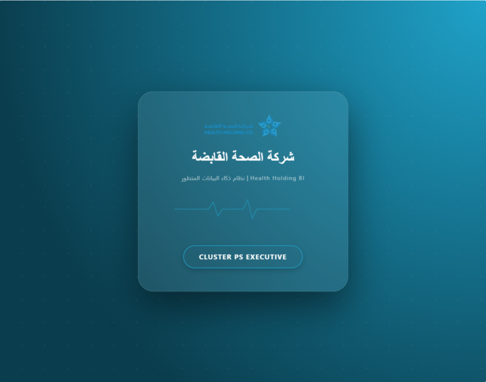
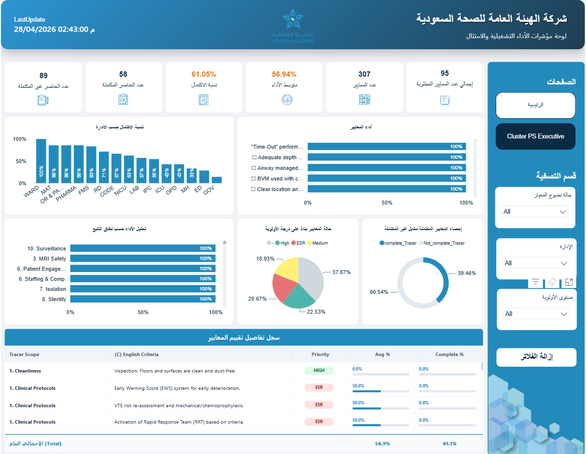

# Health Holding Company | Cluster PS Executive Dashboard 🩺 📊

An executive Data & Analytics solution designed for the **Health Holding Company (شركة الصحة القابضة)** to monitor, evaluate, and track operational performance, compliance, and clinical quality metrics across medical clusters and departments.

---

## 🌟 Overview

This Power BI dashboard serves as a comprehensive command center for leadership and operational teams. It provides deep visibility into hospital/cluster compliance standards, clinical tracer scopes, and performance metrics, ensuring high-standard healthcare delivery and continuous quality improvement.

---

## 📊 Key Performance Indicators & Metrics (KPIs)

The dashboard tracks several critical high-level metrics across the organization:
* **Total Required Criteria (إجمالي عدد المعايير المطلوبة):** 95
* **Total Criteria (عدد المعايير):** 307
* **Average Performance (متوسط الأداء):** 56.94%
* **Completion Rate (نسبة الاكتمال):** 61.05%
* **Completed Elements (عدد العناصر المكتملة):** 58
* **Incomplete Elements (عدد العناصر غير المكتملة):** 89

---

## 🚀 Key Features & Visualizations

1. **Department Completion Breakdown (نسبة الاكتمال حسب الإدارة):** Bar charts showing completion percentages across various departments/clusters (e.g., WARD, MAT, OR & PARM, PHARMA, FMS, RD, CODE, NICU, LAB, IPC, ICU, OPD, MH, ED, GOV).
2. **Criteria Performance (أداء المعايير):** Detailed tracking of performance for specific clinical protocols and safety measures (e.g., Time-Out performance, Adequate depth, Airway managed, BVM used, Clear location).
3. **Tracer Scope Performance Analysis (تحليل الأداء حسب نطاق التتبع):** Evaluation across major operational and clinical scopes such as:
   - Cleanliness
   - MRI Safety
   - Patient Engagement
   - Staffing & Comp.
   - Isolation
   - Sterility
4. **Priority-Based Criteria Status (حالة المعايير بناءً على درجة الأولوية):** Donut/Pie breakdown categorized by priority levels (**High**, **ESR**, **Medium**).
5. **Complete vs. Incomplete Tracer Statistics (إحصاء المعايير المكتملة مقابل غير المكتملة):** Visual representation of completed tracers (`complete_Tracer`) versus incomplete tracers (`not_complete_Tracer`).
6. **Tracer Assessment Details Table (سجل تفاصيل تقييم المعايير):** A comprehensive grid displaying Tracer Scope, English Criteria description, Priority, Average %, and Completion %.
7. **Interactive Filtering System (قسم التصفية):** Dynamic slicers and filters for filtering by Criterion Maturity State, Department/Administration, and Priority Level, complete with a quick reset button ("إزالة الفلاتر").

---

## 🛠️ Technical Stack & Design

* **Tool:** Microsoft Power BI
* **Design Philosophy:** Dark Glassmorphic UI featuring sleek dark-blue gradients, glowing card elements, and a clean medical aesthetic tailored for executive stakeholders.
* **Data Modeling:** Star schema architecture integrating multiple operational and compliance data sources.

---

## 🔒 Confidentiality & NDA Note
> *Note: Due to data privacy, organizational security policies, and Non-Disclosure Agreements (NDA), the raw `.pbix` Power BI source file and proprietary organizational datasets are confidential and not included in this public repository. Only visual previews and structural documentation are showcased.*
---

## 💼 Work Opportunities & Contact Information

I am a **Data Analyst** specializing in building high-impact Power BI solutions, DAX modeling, custom UI design, and operational dashboards.

🟢 **Available for Freelance Projects & Full-Time Job Opportunities.**

* **Phone / WhatsApp:** [+966 56 302 0230](https://wa.me/966563020230)
* **LinkedIn Profile:** [Belal Farrag on LinkedIn](https://www.linkedin.com/in/belal-farrag-b976b01a4/)
